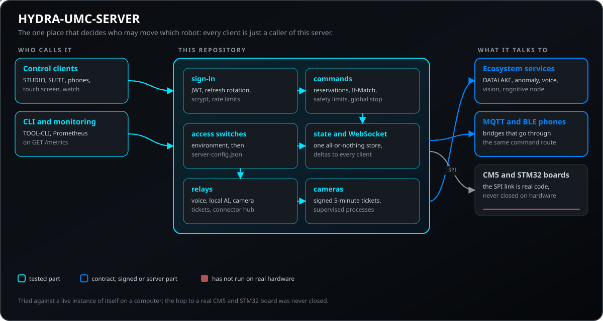
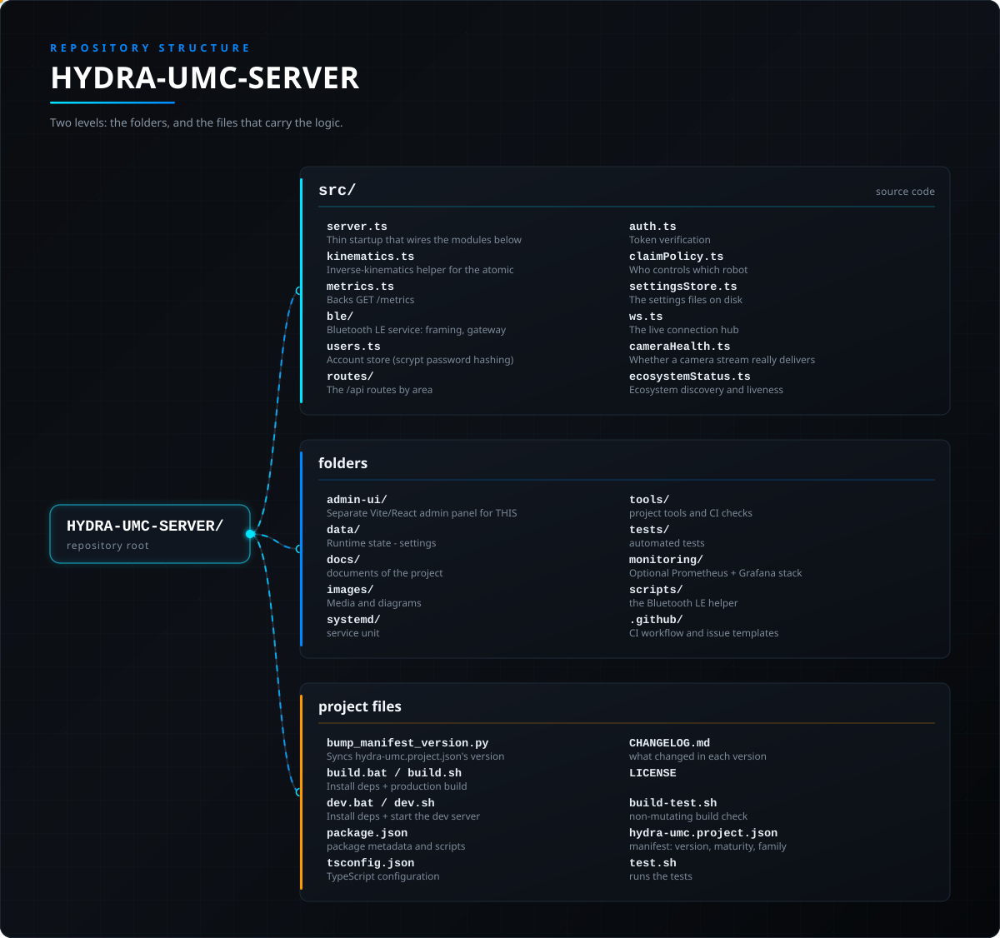

<!-- =============================================================================
HYDRA-UMC-SERVER - Headless REST and WebSocket backend of the HYDRA-UMC micro-factory
Copyright (C) JuanenRac (Electro Hobby 3D) <electrohobby3d@gmail.com>
GPL-3.0-or-later - see LICENSE
============================================================================= -->

<p align="center">
  
</p>

# 🤖 HYDRA-UMC-SERVER

<p align="center"><a href="README.md">🇺🇸 English</a> | <a href="README_spa.md">🇪🇸 Español</a> | <a href="README_fra.md">🇫🇷 Français</a> | <a href="README_ita.md">🇮🇹 Italiano</a> | 🇩🇪 <b>Deutsch</b> | <a href="README_zho.md">🇨🇳 简体中文</a> | <a href="README_jpn.md">🇯🇵 日本語</a> | <a href="README_por.md">🇵🇹 Português</a></p>

### 🤖 Headless API/WebSocket-Backend für die HYDRA-UMC Multi-Roboter-Mikrofabrik

<p align="center">
  
  
  
  
  
  
  
  
</p>

---

> **Ehrlichkeitscheck - was heute wirklich läuft:** die Express- + WebSocket-Engine, ihre REST- und WebSocket-Oberfläche (63 Operationen in 58 Pfaden), JWT-Anmeldung mit Refresh-Token-Rotation und scrypt, mDNS-Erkennung, Roboterreservierungen und Revisionen, Wiedergabe sowie die Relays zu CAN-OTA, Telemetrie, Sprache, den lokalen KI-Diensten und dem Connector-Hub sind echt und gegen eine laufende Instanz genau dieses Servers getestet, die die Tests selbst starten: 414 Unit-Tests plus 28 End-to-End-Vertragsskripte, alle bestanden. Was hardwarenah und hier nicht geprüft ist: die Verbindung zu einer echten HYDRA-UMC-CM5 mit STM32H745-Platine, echter Code, der nur über die API- und Vertragsschicht geprüft wurde. TLS, Bluetooth LE, die MQTT-Bridge und der Prometheus- und Grafana-Stack sind echt, optional und standardmäßig aus.

---

> **Stand von Sicherheit (Safety) und Security:** Dieses Ökosystem ist kein zertifiziertes Sicherheitssystem. Es gibt noch keinen Hardware-E-STOP-Pfad, keine von der Firmware durchgesetzten Grenzen oder Verriegelungen und keinen verifizierten Bewegungsbefehl; Firmware-Images werden mit CRC-32 und einer Ed25519-Signatur geprüft, und ein Release-Build verweigert die veröffentlichten Entwicklungsschlüssel (die Werkzeugköpfe und Erweiterungsplatinen hinter dem Relais laufen noch mit URTC-Bootloadern, die statt einer Signatur ein HMAC-SHA256 mit gemeinsamem Schlüssel verwenden); TLS und gegenseitiges TLS sind optional und standardmäßig aus; noch keine eigene Platine wurde bestückt oder getestet. Lesen Sie die [Sicherheitsbasis](https://github.com/JuanenRac/HYDRA-UMC-DOCS/blob/main/docs/SECURITY_BASELINE.md) und das [Bedrohungsmodell](https://github.com/JuanenRac/HYDRA-UMC-DOCS/blob/main/docs/THREAT_MODEL.md), bevor Sie sich für die Sicherheit einer Person auf eine Aussage hier verlassen.

---

## 📋 Auf einen Blick

| | |
|---|---|
| Version | `0.8.1.3` |
| Reifegrad | Funktionsfähig |
| Tests | 414 (`npm run test:unit`) |
| Technik | Node.js 20+ / Express / WebSocket (ws) / REST/OpenAPI |
| Ziel | Der Raspberry Pi CM5 einer HYDRA-UMC-Zelle |
| Auf echter Hardware | Auf einem Prüfstand gelaufen: die Ehrlichkeitsprüfung oben sagt, welche Teile auf echter Hardware liefen |

**Springe zu:** [Überblick](#-überblick) · [Architektur](#-architektur) · [Funktionen](#-funktionen) · [Sicherheit und Schutz](#-sicherheit-und-schutz) · [Schnittstellen](#-schnittstellen) · [Konfiguration](#-konfiguration) · [Schnellstart](#-schnellstart) · [Tests](#-tests) · [Fehlerbehebung](#-fehlerbehebung) · [Struktur des Repositorys](#-struktur-des-repositorys) · [Verwandte Projekte](#-verwandte-projekte)

## 🚦 Projektstatus

Jede Zeile ist ein Teil dieses Repositorys, und die Ampel sagt, wie weit er heute ist. Sie beruht auf dem, was das Repository zeigen kann (Tests, Builds, Läufe), nicht auf dem, was geplant ist.

🟢 Fertig und überprüft · 🟡 Funktioniert, mit bekannten Grenzen · 🟠 Teilweise fertig oder noch nicht überprüft · 🔴 Nicht gemacht oder funktioniert nicht

| Bereich | Stand | Was das hier bedeutet |
|---|---|---|
| Software | 🟡 | Funktioniert für seinen Hauptzweck; die Ehrlichkeitsprüfung oben nennt, was noch fehlt |
| Tests | 🟢 | 414 automatische Tests, bei jeder Änderung ausgeführt |
| Echte Hardware | 🟡 | Auf einem Prüfstand gelaufen: die Ehrlichkeitsprüfung oben sagt, welche Teile auf echter Hardware liefen |
| Dokumentation | 🟢 | README in acht Sprachen, bei jeder Änderung gegen das Manifest geprüft |

## 🎯 Überblick

HYDRA-UMC SERVER ist das eigenständige Backend, das eine
Multi-Roboter-Mikrofabrikzelle von HYDRA-UMC steuert: eine
Node.js/Express + WebSocket-Engine, die den Roboterzustand besitzt, ihn
auf der Festplatte persistiert, jeden Schreibvorgang authentifiziert und
Live-Updates an jeden verbundenen Client sendet. Sie wird ohne eigene Benutzeroberfläche oder Frontend-Build-Schritt
ausgeliefert - sie ist ein reiner API + WebSocket-Dienst, gedacht für den
headless-Betrieb (ohne Browser, ohne Bildschirm) auf der Maschine, die
tatsächlich neben den Robotern steht (typischerweise ein Raspberry Pi
CM5).

Der zweite Vertrag ist vollständig: bedingte Schreibzugriffe (`If-Match` bei Befehlen und Reservierungen, `GET /api/robot/:id`), der atomare Befehl `table`, ein nur anhängbares Prüfprotokoll (`GET /api/audit`, hash-verkettet, abschaltbar) und eine WebSocket-Nachricht `claims`. Kamerapasswörter erscheinen nicht mehr in der Prozessliste oder im Protokoll. Siehe `docs/CONTRACT_V2.md`.

Sie KANN optional auch das bereits gebaute Frontend von
**[HYDRA-UMC STUDIO](https://github.com/JuanenRac/HYDRA-UMC-STUDIO)** als
statische Dateien ausliefern, für das übliche "alles auf einer Maschine,
ein Ursprung"-Deployment - führe einmal **`build-frontend.sh`/`.bat`**
aus (baut STUDIO aus einem Geschwister-Checkout und kopiert das Ergebnis
in das eigene, von Git ignorierte `public/` dieses Repos) und dieser
Server liefert es ab dem nächsten Start unter `/` aus. Das ermöglicht es
HYDRA-UMC-ANDROID-CONTROL, HYDRA-UMC-IOS-CONTROL und HYDRA-UMC-DSI, den
echten 3D-Viewport von STUDIO in ihrer eigenen In-App-WebView einzubetten,
die auf dieselbe ip:Port dieses Servers zeigt. Vollständig optional: ohne
dieses Skript bleibt dieser Server genauso headless wie oben beschrieben
- `public/` existiert dann einfach nicht, und alle Routen funktionieren
weiterhin identisch.

Dasselbe `build-frontend.sh`/`.bat` baut auch das eigene
**[`admin-ui/`](admin-ui/README.md)** dieses Repos - ein kleines,
separates Panel zur Verwaltung dieses SERVERS selbst (verbundene Geräte,
seine eigene Log-Datei, sein eigener Port/Name, seine eigenen
Benutzerkonten), ausgeliefert unter `/admin`. Das ist bewusst KEINE
Robotersteuerung (die bleibt STUDIO-exklusiv) - eine gezielte,
ausdrückliche Ausnahme vom headless-Design oben, keine Abkehr davon.

Dieses Projekt war früher Teil von **[HYDRA-UMC STUDIO](https://github.com/JuanenRac/HYDRA-UMC-STUDIO)**,
das als "hybrides Monolith" ausgeliefert wurde: ein einziger
Node.js-Prozess, der sowohl die Roboter-Steuerungs-Engine ausführte *als
auch* das Vite/React-Web-Dashboard bediente (mit Vites eigenem
Entwicklungs-Middleware direkt in dieselbe Express-App eingebunden).
Dieser Prozess wurde in zwei Teile aufgespalten:

- **HYDRA-UMC SERVER** *(dieses Repository)* - die Engine:
  Roboter-/Controller-Zustand, die REST + WebSocket-API,
  Authentifizierung, mDNS-Erkennung, Modell-Einreichungen. Keine UI, kein
  Bundler, kein Frontend-Build-Schritt.
- **[HYDRA-UMC STUDIO](https://github.com/JuanenRac/HYDRA-UMC-STUDIO)** - jetzt
  ein reiner Vite/React-Client, der über das Netzwerk mit diesem Server
  spricht, genau wie jeder andere Client dieser API bereits.

## 🧩 Rolle in HYDRA-UMC

**HYDRA-UMC-SERVER** ist der Motor der Zelle: ein Node.js- und Express-Backend ohne Oberfläche, das den Roboterzustand hält, auf Platte speichert, jeden Schreibzugriff mit einer Rolle verlangt und Live-Updates über einen einzigen WebSocket an alle Clients schickt. Alle Clients (STUDIO, SUITE, die Handy-Apps, der Touchscreen, die Uhr, das Kommandozeilenwerkzeug) laufen über ihn, und er allein entscheidet, wer welchen Roboter wie weit bewegen darf.

## 🏛️ Architektur

<p align="center">
  
</p>

### Warum Dieses Projekt Existiert

Die Trennung der Engine vom Web-Dashboard war eine bewusste Entscheidung,
kein Refactoring um seiner selbst willen:

- **Ressourcenisolierung.** Eine schwere 3D-Ansicht, die den eigenen
  Browser-Tab erstickt, teilt sich keinen Prozess (und damit keine
  CPU/I-O-Konkurrenz) mehr mit dem Code, der tatsächlich für die
  Bewegung der Roboter verantwortlich ist. Wenn die Web-UI hängt,
  beantwortet dieser Server weiterhin Not-Aus-Befehle von jedem anderen
  verbundenen Client.
- **Ein echter headless-Controller.** Dieser Prozess kann laufen, ohne
  dass jemals eine UI auf dem Host geladen wird - das "Gehirn" einer
  industriellen Zelle braucht keinen geöffneten Browser-Tab, um zu
  funktionieren. Gibt RAM/CPU auf eingeschränkter Hardware (einem
  Raspberry Pi CM5) für den Teil der Arbeit frei, der wirklich zählt:
  Kinematik und Steuerung.
- **Unabhängige Lebenszyklen.** Die Web-UI kann neu bereitgestellt,
  neugestartet oder gegen einen neueren Build ausgetauscht werden, ohne
  jemals diesen Prozess zu berühren - keine Ausfallzeit der
  Robotersteuerung nur um einen UI-Fix auszuliefern.
- **Flexibles Hosting.** Dieser Server ist dafür gedacht, auf (oder
  direkt neben) der Hardware zu laufen, die er steuert; der Client, der
  ihn darstellt, kann komplett woanders gehostet werden, erreichbar über
  das Netzwerk genau wie die anderen entfernten Clients dieser selben
  API.

## ✨ Funktionen

### Daten und Persistenz

Alles, was dieser Server besitzt, lebt unter `data/`, das beim ersten
Start automatisch erstellt wird:

- `data/settings.json` - der vollständige Zustandsbaum: Controller,
  Roboter, Systemkonfiguration. Wird nie als statische Datei
  ausgeliefert (explizites 404) - nur über die authentifizierte Route
  `/api/settings` erreichbar.
- `data/users.json` - Kontozugangsdaten (scrypt-gehasht, gesalzen, nie
  Klartext). Ebenfalls nie statisch ausgeliefert.
- `data/logs/server.log` - nur anhängendes Industrieprotokoll jedes
  Befehls.
- `data/WORKS/` - gespeicherte Roboter-Trajektorien, standardmäßig ein
  Ordner pro Roboter, als einfache statische Dateien ausgeliefert (Index
  + einzelne Arbeitsdateien).
- `data/model_submissions.json` + die eingereichten Modellordner selbst -
  die Serverseite des Ablaufs von
  [HYDRA-UMC-EDITOR-URDF](https://github.com/JuanenRac/HYDRA-UMC-EDITOR-URDF),
  um "ein fertiges Robotermodell direkt in den Katalog dieses Servers zu
  übertragen".
- `data/totp.json` - der zweite Faktor der Konten, die ihn eingeschaltet haben (optional, für jedes Konto aus, bis sein Besitzer ihn einschaltet): Jedes Geheimnis ist mit AES-GCM unter `HYDRA_UMC_TOTP_KEY` (oder einem aus `JWT_SECRET` abgeleiteten Schlüssel) verschlüsselt, und die zehn Wiederherstellungscodes werden nur als Hashes gehalten; die Datei existiert nicht, bis ein Konto den zweiten Schritt einschaltet.

## 🔒 Sicherheit und Schutz

| Bedrohung | Abwehr | Wo |
|---|---|---|
| Mit einem bekannten Schlüssel signierte Tokens | Mit `NODE_ENV=production` weigert sich der Server zu starten, wenn `JWT_SECRET` leer, ein Beispiel oder zu kurz ist oder ein Start-Administrator fehlt; in der Entwicklung gilt ein eingebauter Wert und eine `[SECURITY]`-Warnung wird ausgegeben | `src/auth.ts`, `src/secretsPolicy.ts` |
| Brute Force auf die Anmeldung oder eine Flut von Stopps | 5 fehlgeschlagene Anmeldungen je 15 Minuten und Adresse (`429`), 120 Refreshs und 60 globale Stopps pro Minute, einstellbar mit `LOGIN_RATE_LIMIT_MAX`, `REFRESH_RATE_LIMIT_MAX` und `STOP_ALL_RATE_LIMIT_MAX`; Passwörter nutzen scrypt mit zufälligem Salz, höchstens 4 gleichzeitig und 20 in der Warteschlange, sodass eine Flut den Server nicht lahmlegt | `src/auth.ts`, `src/users.ts` |
| Ein gestohlener Token oder ein aus der Adresse gelesener Token | Zugriffstokens laufen ab (`JWT_EXPIRES_IN`, standardmäßig 30 Tage, außerhalb eines vertrauenswürdigen LANs 24 h empfohlen) und werden durch ein rotierendes Refresh-Token erneuert; der WebSocket nimmt den Token als Subprotokoll `hydra.bearer` und lehnt `?token=` ab, außer `HYDRA_UMC_WS_QUERY_TOKEN=allow` erlaubt es wieder, mit einer Warnung bei jedem Start | `src/refresh_tokens.ts`, `src/ws.ts` |
| Zwei Clients bewegen denselben Roboter oder ein Befehl, den der Roboter nicht bekommen soll | Ein Roboter ist für ein Konto und Fenster reserviert, Schreibzugriffe brauchen `If-Match` (eine veraltete Revision bekommt `412`), die Betrachterrolle darf nicht schreiben, und die Größe einer Fahrt und das heißeste Heizbett-Ziel stammen aus den Sicherheitsgrenzen, die ein Administrator setzt; der globale Stopp funktioniert, was die Reservierungen auch sagen | `src/claimPolicy.ts`, `src/safetyLimits.ts`, `src/routes/commandRoutes.ts` |
| Kamerabilder, die jedem im Netzwerk offenstehen | Live-Streams, Fotos und Aufnahmen brauchen ein signiertes Ticket mit 5 Minuten Laufzeit (oder einen Bearer-Token); höchstens 8 Kameras; Kamerapasswörter bleiben aus der Prozessliste und dem Log; `HYDRA_UMC_CAMERA_AUTH=open` ist der vorübergehende Opt-out | `src/mediaTickets.ts`, `src/serverPolicy.ts` |
| Übergroße oder feindliche Anfragen und offener Cross-Origin-Zugriff | JSON-Bodys sind auf 1 MB begrenzt (50 MB nur auf der großen Upload-Route); `CORS_ALLOWED_ORIGINS` ist eine Zulassungsliste, und in der Produktion lehnt eine nicht gesetzte Liste jede Cross-Origin-Browseranfrage ab (die Entwicklung erlaubt jeden Origin, mit Warnung); `settings.json` und `users.json` werden nie als Dateien ausgeliefert | `src/server.ts` |
| Schwache Zugriffsoptionen bleiben an: Sprachtext, Erkennerkonfidenz, MAVLink-Signatur, Bluetooth, MQTT, TLS | Jede hat einen Schalter, den ein Administrator per `PUT /api/admin/server-config` bearbeitet (nur Admin), mit konservativem Standard und der Umgebung über dem Gespeicherten; die Antwort listet Warnungen wie `voice_heard_text_on`, `voice_confidence_off`, `mavlink_unsigned_allowed` und `mavlink_signing_off`; das Sprach-Relay ersetzt alle `options` eines Clients durch die des Administrators, und eine MAVLink-Schlüsseldatei wird geprüft (32 Bytes oder 64 Hexzeichen), bevor ihr Pfad gespeichert wird | `src/securityConfig.ts`, `src/routes/adminRoutes.ts`, `src/routes/assistantRoutes.ts` |
| Ein manipulierter Nachweis, wer was getan hat | Ein nur anhängbarer Audit-Eintrag, dessen Einträge hash-verkettet sind (`GET /api/audit`, `?verify=1` prüft die Kette), ein Serverprotokoll, das nach Größe rotiert, und ein Schwärzungsschritt, der Geheimnisse entfernt, bevor etwas geschrieben wird | `src/auditLog.ts`, `src/logRotation.ts`, `src/redaction.ts` |

**Was er nie tut:** als zertifizierte Sicherheitsfunktion dienen. Die Grenzen und der Stopp sind Software in diesem Prozess; dahinter gibt es noch keinen Hardware-Not-Halt-Pfad, keine von der Firmware erzwungene Grenze und keine echte Steuerplatine.

## 🔌 Schnittstellen

### API- und WebSocket-Oberfläche

Jede Route, der WebSocket-Nachrichtenvertrag, die Authentifizierung und
das Modell für clientweisen Fernzugriff sind in
**[`docs/REMOTE_API.md`](docs/REMOTE_API.md)** dokumentiert - die einzige
verlässliche Quelle für alles, was mit diesem Server spricht,
einschließlich des eigenen Client-Codes von HYDRA-UMC STUDIO. Kurz
zusammengefasst:

- REST-API unter `/api/*` - Lesen/Schreiben von Settings, atomare
  Roboterbefehle (jog/play/pause/stop/tool/valve/pump/speed/vision),
  Kontoverwaltung, Upload/Download von Arbeitsdateien, Modell-Einreichung,
  Systemmetriken, Erkennung.
- Ein einziger `/ws` WebSocket-Endpunkt (Bearer-Token als Subprotokoll `hydra.bearer` ein Token im Query-String wird abgelehnt, solange die Installation es nicht wieder erlaubt),
  der bei jeder Zustandsänderung vollständige `settings`-Snapshots und
  leichtere `delta`-Updates an jeden verbundenen Client sendet.
- `POST /api/stop-all` ist der globale Stopp: ein Aufruf, offen für jedes angemeldete Konto, stoppt alle Roboter und schaltet alle Ventile und Pumpen aus,
  unabhängig von jeder Reservierung, und antwortet mit einem Ergebnis pro Roboter.
- Bluetooth LE (standardmäßig aus): Ein Telefon in der Nähe der CM5 kann den Zustand der Roboter lesen und, wenn ein Administrator es erlaubt, Befehle senden, die der Server erst bestätigt, nachdem dieselbe Route geantwortet hat, die auch ein Netzwerk-Client nutzt. Siehe [`docs/BLE_GATT.md`](docs/BLE_GATT.md).
- JWT-Bearer-Token-Authentifizierung bei jedem Schreibvorgang; drei
  Kontorollen (`admin`, `operator`, schreibgeschütztes `viewer`) trennen Settings-/Benutzerverwaltungs-
  Schreibvorgänge vom täglichen Roboterbetrieb und vom reinen Lesen.
- `_hydra._tcp` mDNS/Bonjour-Ankündigung für zero-config-Erkennung im
  lokalen Netzwerk, plus ein einfaches `GET /api/hydra-info` für einen
  Subnetz-Scan.
- `GET /metrics` - Prometheus-Expositionsformat (`prom-client`), für das
  optionale Grafana-Dashboard, beschrieben unter "📊 Monitoring" weiter
  unten.

CORS ist über eine konfigurierbare Allowlist aktiviert
(`CORS_ALLOWED_ORIGINS`, siehe "Umgebungsvariablen" weiter unten), da die
Clients dieses Servers nicht mehr garantiert seinen eigenen Ursprung
teilen. Unkonfiguriert bleibt es außerhalb von `NODE_ENV=production`
weit offen (heutiges Zero-Config-Verhalten für die lokale Entwicklung);
in Produktion werden alle Cross-Origin-Browseranfragen abgelehnt, bis die
Allowlist gesetzt ist - siehe den Kommentar über
`app.use(cors(corsOptions))` in `src/server.ts` für die vollständige
Begründung.

### Monitoring (Optional)

`GET /metrics` stellt die Prozess-Uptime, verbundene WebSocket-Clients,
die Schreiblatenz von `settings.json`, atomare Roboterbefehle nach Typ,
Authentifizierungsfehler sowie dieselben CPU-/Speicher-/Temperaturwerte
wie `GET /api/system/metrics` bereit - alles im Prometheus-Format. Ein
einsatzbereiter Prometheus + Grafana Stack (mit einem Start-Dashboard)
liegt unter **[`monitoring/`](monitoring/README.md)**: `docker compose up
-d` aus diesem Ordner genügt, um ihn zu starten. Vollständig optional -
nichts davon wird benötigt, damit der Server selbst funktioniert.

| Topic oder Route | Was es trägt |
|---|---|
| `/api/login`, `/api/refresh`, `/api/logout` | anmelden (mit Ratenbegrenzung), Refresh-Token rotieren, abmelden |
| `/api/users`, `/api/users/:username` | Konten auflisten, anlegen, ändern und löschen (`admin`, `operator`, `viewer`); nur Admin |
| `/api/settings`, `/api/robot/:id`, `/api/robot/:id/command` | der Zustandsbaum und die atomaren typisierten Befehle (Fahren, Abspielen, Pause, Stopp, Werkzeug, Ventil, Pumpe, Geschwindigkeit, Vision, Tisch) mit `If-Match` |
| `/api/robot/:id/claim`, `/release`, `/jog-arm`, `/api/claims`, `/api/stop-all`, `/api/safety-limits` | Reservierungen, das Fahren scharf schalten, wer was hält, der globale Stopp und die Sicherheitsgrenzen |
| `/api/admin/server-config`, `/clients`, `/logs`, `/restart`, `/safety-limits` | Administration: die Zugriffsschalter, die verbundenen Apps, das Serverprotokoll, ein Neustart und die Sicherheitsgrenzen; nur Admin |
| `/api/camera/*`, `/api/cameras/status` | Kamerastreams, Schnappschüsse, Aufnahmen, PTZ und `POST /api/camera/ticket` |
| `/api/system/metrics`, `/api/system/supervisor`, `/api/ecosystem/status`, `/api/system/bluetooth/*` | Host-Informationen, die Prozessüberwachung, Status und Steuerung der Ökosystemdienste, Bluetooth-Kopplung |
| `/api/voice/turn`, `/api/voice/confirm`, `/api/watch/system-status`, `/api/ai/*` | Relays zum Sprachdienst, zum Uhrstatus und zu den lokalen KI-Diensten |
| `/ws` | ein WebSocket: vollständige `settings`-Snapshots, leichte `delta`-Updates und eine `claims`-Nachricht; der Token reist als Subprotokoll `hydra.bearer` |
| `GET /api/hydra-info`, `_hydra._tcp` | Erkennung: die Version des Remote-Vertrags (`remoteApiVersion` 2), die App-Version und die Anzahl von Controllern und Robotern, per mDNS angekündigt |
| `/admin`, `/dashboard-ai`, `/` | optionale statische Seiten, nur ausgeliefert, wenn `build-frontend` sie neben diesem Repository gebaut hat: das Admin-Panel, DASHBOARD-AI und STUDIO |
| `/metrics` | Prometheus-Text: Laufzeit, WebSocket-Clients, Schreiblatenz, Befehle nach Typ, Authentifizierungsfehler, Host-Werte |

## ⚙️ Konfiguration

### Umgebungsvariablen

Optional - der Server läuft ohne jede Konfiguration, mit
entwicklungsfreundlichen Standardwerten für jede Variable unten. Setzen
Sie echte Werte, bevor dieser Server über ein vollständig
vertrauenswürdiges LAN hinaus freigegeben wird - z. B. über das offene
Internet via NAT/Portweiterleitung des Routers, was das Bedrohungsmodell
von "nur vertrauenswürdiges LAN" zu "von jedem erreichbar" ändert (siehe
`.env.example`):

- `JWT_SECRET` - signiert jedes Login-Token. Falls nicht gesetzt, wird
  stattdessen ein fester Entwicklungswert aus `src/server.ts` verwendet
  (in Ordnung für die lokale Entwicklung, nicht für ein Deployment
  außerhalb eines vertrauenswürdigen Netzwerks). Exportieren Sie sie über
  Ihre Shell oder über Ihren bevorzugten Prozessmanager/Container
  (systemd `Environment=`, die Umgebungskonfiguration von `pm2`, Docker
  `-e`, ...).
- `NODE_ENV` - setzen Sie `production` für jedes reale Deployment.
  Steuert die beiden Fallbacks unten (offenes CORS, stille Standardwerte)
  und aktiviert deutlich sichtbare Start-Warnungen, falls `JWT_SECRET`
  oder das geseedete `admin`/`admin`-Konto noch auf ihren Standardwerten
  stehen. Nicht gesetzt (oder jeder andere Wert) behält das heutige
  permissive Entwicklungsverhalten bei.
- `CORS_ALLOWED_ORIGINS` - kommagetrennte Liste von Ursprüngen, die
  Cross-Origin-Browseranfragen an diese API stellen dürfen - der reale
  Fall, auf den es hier ankommt, ist HYDRA-UMC STUDIO, das von einem
  anderen Host/Port als diesem Server ausgeliefert wird (z. B.
  `https://studio.example.com`, oder `http://192.168.1.20:5173` in der
  Entwicklung). Beispiel:
  `CORS_ALLOWED_ORIGINS=https://studio.example.com,http://192.168.1.20:5173`.
  Falls nicht gesetzt: `NODE_ENV != production` erlaubt jeden Ursprung
  (keine Konfiguration für die lokale Entwicklung nötig, entspricht dem
  bisherigen Verhalten dieses Projekts); `NODE_ENV = production`
  **verweigert** stattdessen jede Cross-Origin-Browseranfrage, bis dies
  gesetzt ist, mit einer deutlich sichtbaren Start-Warnung. Nicht-Browser-
  Clients (curl, HYDRA-UMC SUITE, die mobilen Apps) sind in beiden
  Fällen nie betroffen - CORS ist ein reiner Browser-Mechanismus.
- `JWT_EXPIRES_IN` - wie lange ein Login-Token gültig bleibt. Jede
  Zeichenkette, die die `expiresIn`-Option von `jsonwebtoken` selbst
  akzeptiert (`"24h"`, `"7d"`, eine reine Sekundenzahl, ...). Standardmäßig
  `30d`, falls nicht gesetzt (die ursprüngliche Annahme dieses Projekts
  eines vertrauenswürdigen LANs). **Ein Server, der über ein
  vertrauenswürdiges LAN hinaus erreichbar ist, sollte dies deutlich
  kürzer setzen - `24h` ist ein vernünftiger Ausgangspunkt** - ein
  geleaktes langlebiges Token kann nicht einzeln widerrufen werden, außer
  durch Ändern des Passworts dieses Kontos.
- `LOGIN_RATE_LIMIT_MAX` / `LOGIN_RATE_LIMIT_WINDOW_MS` - drosselt
  ausschließlich `POST /api/login` (alle anderen Routen sind nicht
  betroffen). Standardmäßig 5 Versuche pro 15 Minuten pro IP, falls eine
  der beiden nicht gesetzt ist; ein ausgelöstes Limit antwortet mit `429`
  und einer klaren JSON-Fehlermeldung, nicht mit einem generischen `500`.
- `REFRESH_RATE_LIMIT_MAX` - Anfragebudget von `POST /api/refresh` pro Zeitfenster und IP (Standard 120). Für das obige Login-Limit zählen nur fehlgeschlagene Anmeldungen.
- `TLS_CERT_PATH` / `TLS_KEY_PATH` - setzen Sie **beide**, um den Server
  (REST-API + den `/ws`-WebSocket, der denselben Listener teilt) von
  einfachem HTTP/WS auf HTTPS/WSS umzuschalten. Siehe "TLS / HTTPS"
  unten. Wird eine der beiden nicht gesetzt, bleibt das heutige
  Klartext-HTTP-Verhalten unverändert.
- `HYDRA_UMC_CAMERA_AUTH` - die Kamerabilder (Live-Streams, gespeicherte Fotos und Aufnahmen) verlangen **standardmäßig** ein kurzlebiges `?ticket=` (`POST /api/camera/ticket` gibt es an einen angemeldeten Client aus) oder ein Bearer-Token; `HYDRA_UMC_CAMERA_AUTH=open` ist der vorübergehende Ausweg für Clients, die noch keine Tickets anfordern.
- `HYDRA_UMC_WS_QUERY_TOKEN` - `/ws?token=` wird **standardmäßig abgelehnt** (das Token reist als Subprotokoll `hydra.bearer`); `HYDRA_UMC_WS_QUERY_TOKEN=allow` ist der vorübergehende Ausweg für Clients, die noch nicht umgestellt haben. Der Server warnt bei jedem Start, solange ein Ausweg gesetzt ist.
- `HYDRA_UMC_BLE_GATT` - der Bluetooth-LE-Dienst: `off` (Standard), `state` (Telefone lesen den Zustand) oder `commands` (und senden Befehle, jeweils mit dem Zugriffstoken des Kontos). `HYDRA_UMC_BLE_ENCRYPTION=off` verlangt keine verschlüsselte Verbindung mehr (standardmäßig wird sie verlangt). Beides lässt sich auch im Server-Admin-Bildschirm einstellen; eine Änderung gilt ab dem nächsten Start. Benötigt BlueZ, `python3-dbus` und `python3-gi` auf dem Rechner.
- `HYDRA_UMC_MQTT_BRIDGE` - die Brücke zum MQTT-Broker der Zelle: `off` (Standard), `state` (der Zustand jedes Roboters geht auf retained Topics hinaus) oder `commands` (und ein auf dem Topic eines Roboters veröffentlichter Befehl wird über dieselbe Route wie bei einem Netzwerk-Client ausgeführt, mit dem Token eines eigenen Kontos, das `HYDRA_UMC_MQTT_COMMAND_USER` benennt). Adresse, Topic-Präfix und Benutzernamen lassen sich auch im Server-Admin-Bildschirm setzen; die Passwörter nur über die Umgebung. Siehe [`docs/MQTT_BRIDGE.md`](docs/MQTT_BRIDGE.md).
- `HYDRA_UMC_INFO_AUTH=required` - verlangt für die schreibgeschützten Geräteinformationen (`/metrics`, `/api/system/metrics`, `/api/system/supervisor`, `/api/ecosystem/status`, `/api/models`) einen angemeldeten Client. Standardmäßig aus, damit ein Client, der sein Token auf diesen Routen noch nicht sendet, weiter funktioniert; ein Produktionsstart warnt, solange es aus ist.
- `HYDRA_UMC_VOICE_UI_INCLUDE_HEARD_TEXT`, `HYDRA_UMC_VOICE_UI_MIN_CONFIDENCE`, `HYDRA_UMC_BRIDGE_UAV_SIGNING_KEY_FILE`, `HYDRA_UMC_BRIDGE_UAV_SIGNING_ALLOW_UNSIGNED` - die Sprach- und UAV-Optionen, die ein Administrator auch in Server Admin setzen kann (`voice` und `mavlink` in `data/server-config.json`): ob eine Sprachantwort das Gesagte wiederholt (`1` schaltet es ein; standardmäßig aus), die Mindestsicherheit der Spracherkennung (0 bis 1, Standard 0,6), bevor eine Anfrage angenommen wird, die eine Bewegung startet, sowie die Schlüsseldatei der MAVLink-2-Signatur und ob unsignierte Nachrichten weiter angenommen werden (standardmäßig keine Signatur und unsignierte werden abgewiesen). Die Umgebung hat Vorrang vor dem Gespeicherten; dann zeigt der Bildschirm den Wert als fest an.
- `HYDRA_UMC_AI_ACCESS=admin` - beschränkt das Relay zu den lokalen KI-Diensten (`/api/ai/*`) auf Administratoren. Standardmäßig aus, sodass wie bisher jeder angemeldete Benutzer es nutzen kann.
- `HYDRA_UMC_VISUAL_SERVOING_TOKEN`, `HYDRA_UMC_VLA_ENGINE_TOKEN`, `HYDRA_UMC_COGNITIVE_NODE_TOKEN`, `HYDRA_UMC_DETECTION_HEF_TOKEN`, `HYDRA_UMC_VISION_NODE_TOKEN` und `HYDRA_UMC_ANOMALY_TOKEN` (für das Relay `/api/ai/*`), `HYDRA_UMC_VISION_STREAMER_TOKEN` (für die Kamerastreams) und `HYDRA_UMC_DATALAKE_READ_TOKEN`, sonst `HYDRA_UMC_DATALAKE_TOKEN` (für die Telemetrie) - das Bearer-Token, das dieser Server einem Dienst vorlegt, der eines verlangt; jede liest auch `..._FILE`, eine Datei, deren erste Zeile das Token ist. Es sind die Namen, die die Dienste selbst lesen, eine einzige Umgebungsdatei bedient also beide, und kein Client sieht sie je. Ein Dienst ohne konfiguriertes Token wird genau wie vorher erreicht. Das Relay lehnt außerdem eine Sitzung ab, die weder Administrator noch Bediener ist, und nur ein Administrator darf die Referenz des Anomalie-Detektors ändern (jedes `POST` außer `/detect`); `vision-node` und `anomaly-detector` kommen zum Relay hinzu.
- `HYDRA_UMC_VOICE_UI_RESULT_KEY` (oder `..._FILE`) - der Schlüssel, mit dem HYDRA-UMC-VOICE-UI ein bestätigtes Sprachergebnis signiert (16 Zeichen oder mehr, derselbe Wert, den es hält). `POST /api/voice/confirm` leitet eine Bestätigung mit dem angemeldeten Benutzer als Subject weiter und glaubt eine `confirmed`-Antwort nur, wenn sie diesen Benutzer nennt und ihre Signatur stimmt; ohne den Schlüssel wird die Antwort mit `verified: false` weitergereicht, und `HYDRA_UMC_VOICE_CONFIRM_REQUIRE_SIGNATURE=1` lehnt sie stattdessen ab. Diese Route führt nichts aus.
- `HYDRA_UMC_TELEMETRY_COLLECTOR_URL` (mit `HYDRA_UMC_TELEMETRY_COLLECTOR_TOKEN` oder `..._FILE` und `HYDRA_UMC_TELEMETRY_INTERVAL_MS`, 100 bis 60000, standardmäßig 1000) - schaltet den Telemetrie-Produzenten ein: Die Zahlen jedes Roboter-Deltas, das dieser Server sendet (Position, Gelenke, Wiedergabestatus), gehen als ein `robot_state`-Sample pro Roboter an HYDRA-UMC-TELEMETRY-COLLECTOR, höchstens eines pro Intervall und zusammengeführt, damit der Data Lake etwas Echtes zu speichern hat. Aus, wenn die Adresse fehlt; er verzögert nie einen Befehl, hält eine begrenzte Datenmenge und pausiert nach einem Fehler 30 Sekunden.
- `/dashboard-ai` - wenn HYDRA-UMC-DASHBOARD-AI neben diesem Repository ausgecheckt ist, baut `build-frontend` es und dieser Server liefert es dort aus. Die Seite liest den Data Lake (`/api/ai/datalake/*`, nur lesend: `GET` auf `/query`, `/aggregate`, `/stats`, `/stats/range`, `/series` und `/health`, alles andere wird abgelehnt) und den Anomalie-Detektor (`/api/ai/anomaly-detector/*`) über das Relay, mit der Sitzung der Person, die sich im selben Browser in STUDIO angemeldet hat; so gelten die Rollen und die Dienst-Token dieses Servers. Damit kann der Anomalie-Detektor mit `HYDRA_UMC_ANOMALY_PROTECT_READS=1` gestartet werden.
- `HYDRA_UMC_LOG_MAX_BYTES` und `HYDRA_UMC_LOG_KEEP` - die Größe, ab der das Serverprotokoll rotiert (Standard 10 MB), und wie viele rotierte Dateien behalten werden (Standard 1).
- `HYDRA_UMC_SETTINGS_STORE`, `HYDRA_UMC_SETTINGS_BACKUPS` und `HYDRA_UMC_SETTINGS_BACKUP_INTERVAL_S` - standardmäßig werden die Einstellungen (`settings.json` und die Punktedateien) als eine Alles-oder-nichts-Einheit mit Journal geschrieben: Ein unterbrochener Schreibvorgang wird beim nächsten Start abgeschlossen oder verworfen, eine Kopie von `settings.json` liegt in `data/backups/` (10 Kopien, höchstens eine alle 600 s) und eine beschädigte `settings.json` wird aus der neuesten guten Kopie wiederhergestellt. `HYDRA_UMC_SETTINGS_STORE=plain` kehrt zum Schreiben Datei für Datei zurück; `HYDRA_UMC_SETTINGS_BACKUPS=0` schaltet die Kopien ab.
- Der Zugriff auf das KI-Relay, die Anmeldepflicht der Host-Informationen und TLS (Pfade von Zertifikat und Schlüssel, mit dem SHA-256-Fingerabdruck des Zertifikats) kann ein Administrator auch im Bildschirm Server-Verwaltung der Steuer-App ändern. Ein in der Umgebung gesetzter Wert hat Vorrang und wird als gesperrt angezeigt; vor dem Abschalten der Anmeldepflicht wird um Bestätigung gebeten; TLS gilt ab dem nächsten Start.
- `STOP_ALL_RATE_LIMIT_MAX` / `STOP_ALL_RATE_LIMIT_WINDOW_MS` - Budget des globalen Stopps (`POST /api/stop-all`) pro Adresse, getrennt von dem der Anmeldung (Standard 60 pro Minute). In Produktion verweigert der Server außerdem den Start mit einem Beispiel-`JWT_SECRET` oder -Startpasswort aus einer Deployment-Vorlage, einem `JWT_SECRET` unter 32 Zeichen oder einem Startpasswort unter 12 Zeichen.

### TLS / HTTPS

Standardmäßig deaktiviert - dieser Server lief schon immer als einfaches
HTTP/WS und tut das weiterhin, sofern nicht explizit aktiviert. Setzen
Sie sowohl `TLS_CERT_PATH` als auch `TLS_KEY_PATH` (siehe oben) auf ein
PEM-Zertifikat und den passenden privaten Schlüssel, und der gemeinsame
REST-+-WebSocket-Listener wechselt zu `https.createServer()` - `/ws` wird
dabei automatisch zu WSS, ohne separate Konfiguration. Ein gesetzter,
aber unlesbarer oder ungültiger Zertifikat-/Schlüsselpfad lässt den Start
laut fehlschlagen (ein echter `fs`-Fehler), statt still auf einfaches
HTTP zurückzufallen.

Das ist vor allem relevant, sobald dieser Server über ein vollständig
vertrauenswürdiges LAN hinaus erreichbar ist (z. B. über
NAT/Portweiterleitung des Routers für Remote-Tests freigegeben) - einfaches
HTTP bedeutet, dass jedes Bearer-Token, jeder Roboterbefehl und der
Admin-/Operator-Login selbst im Klartext über das Netzwerk laufen.

Ein Zertifikat besorgen:

- **Sie besitzen eine Domain, die auf diesen Server zeigt** - verwenden
  Sie [Let's Encrypt](https://letsencrypt.org/) (z. B. über
  [Certbot](https://certbot.eff.org/)) für ein echtes, browser-
  vertrauenswürdiges Zertifikat, kostenlos und automatisch erneuerbar.
  Zeigen Sie `TLS_CERT_PATH` / `TLS_KEY_PATH` auf das resultierende
  `fullchain.pem` / `privkey.pem`.
- **Lokale Tests, ohne Domain** - ein selbstsigniertes Zertifikat genügt,
  um den HTTPS/WSS-Codepfad zu testen (Browser und die meisten
  HTTP-Clients werden warnen/ein explizites manuelles Vertrauen
  verlangen, was für Tests erwartet und in Ordnung ist):
  ```bash
  openssl req -x509 -newkey rsa:2048 -nodes \
    -keyout key.pem -out cert.pem -days 365 -subj "/CN=localhost"
  ```
  Setzen Sie dann `TLS_CERT_PATH=./cert.pem` und `TLS_KEY_PATH=./key.pem`.

Die folgenden Zugriffsschalter sind die, die der Server-Admin-Bildschirm von STUDIO und SUITE bearbeitet. Jeder wird in derselben Reihenfolge aufgelöst: zuerst die Umgebung des Deployments (der Bildschirm zeigt ihn gesperrt), dann das, was der Administrator in `data/server-config.json` gespeichert hat, dann der konservative Standard. Die oben aufgeführten Variablen decken alles andere ab.

| Variable | Standard | Was sie festlegt |
|---|---|---|
| `aiAccess`, `HYDRA_UMC_AI_ACCESS` | `open` | wer das lokale KI-Relay nutzen darf: `open` ist jedes angemeldete Konto, `admin` nur Administratoren |
| `infoAuth`, `HYDRA_UMC_INFO_AUTH` | aus | für die schreibgeschützten Host-Informationen (Metriken, Prozessüberwachung, Ökosystemstatus) eine Anmeldung verlangen |
| `tls.enabled`, `TLS_CERT_PATH, TLS_KEY_PATH` | aus (einfaches HTTP) | HTTPS und WSS mit dem angegebenen Zertifikat und Schlüssel; der Bildschirm zeigt den Fingerabdruck des verwendeten Zertifikats |
| `ble.mode`, `HYDRA_UMC_BLE_GATT` | `off` | Bluetooth LE für Telefone in der Nähe des Servers: `off`, `state` (nur Zustand veröffentlichen) oder `commands` (auch Befehle annehmen); ein unbekanntes Wort bedeutet aus |
| `ble.requireEncryption`, `HYDRA_UMC_BLE_ENCRYPTION` | an | die Befehls-Characteristic wird nur über eine verschlüsselte Verbindung beschrieben und der Zustand nur so gelesen; nur `off` in der Variable schaltet das ab |
| `mqtt.mode`, `MQTT environment of the deployment` | `off` | die MQTT-Bridge zum Broker der Zelle: `off`, `state` oder `commands`, mit URL, Präfix und Benutzern |
| `voice.includeHeardText`, `HYDRA_UMC_VOICE_UI_INCLUDE_HEARD_TEXT` | aus | eine Sprachantwort wiederholt das Gesagte; das sind personenbezogene Daten, deshalb ist es aus, und in der Variable schaltet nur genau das Wort `1` es ein |
| `voice.minConfidence`, `HYDRA_UMC_VOICE_UI_MIN_CONFIDENCE` | `0.6` | die kleinste Konfidenz des Spracherkenners von 0 bis 1, um eine Anfrage zu akzeptieren, die eine Bewegung startet; 0 schaltet die Prüfung aus, ein Stopp wird nie zurückgehalten, und eine ungültige Zahl in der Variable wird ignoriert |
| `mavlink.signingKeyFile`, `HYDRA_UMC_BRIDGE_UAV_SIGNING_KEY_FILE` | leer (keine Signatur) | MAVLink-2-Signatur der UAV-Bridge: der Pfad einer Datei mit dem 32-Byte-Schlüssel (32 Rohbytes oder 64 Hexzeichen); gespeichert wird nur der Pfad, nie der Schlüssel, und die Bridge liest ihn beim Start |
| `mavlink.signingAllowUnsigned`, `HYDRA_UMC_BRIDGE_UAV_SIGNING_ALLOW_UNSIGNED` | aus | weiterhin unsignierte Nachrichten annehmen (ein Fahrzeug, das noch nicht signiert); der Bildschirm warnt, solange es an ist |

## 🚀 Schnellstart

Benötigt Node.js 22 oder neuer mit npm. Der Server läuft ohne Konfiguration mit entwicklungsfreundlichen Standardwerten; die Variablen des Abschnitts Konfiguration vor dem Betrieb außerhalb eines vertrauenswürdigen LANs setzen.

```bash
npm install
./dev.sh                    # runs the server with tsx on port 3000, no frontend (dev.bat on Windows)
npm run test:unit           # the unit tests
npm test                    # unit tests, the OpenAPI check and the contract scripts against a live instance
npm run build && npm start  # one bundled file (build.sh and build.bat make a versioned release build)
```

Der Server lauscht auf `0.0.0.0:3000`; sein gesamter Zustand liegt in `data/`. Dieses Repository hat absichtlich kein Dockerfile: HYDRA-UMC-OS installiert ihn auf der CM5 (`provisioning/install_server.sh`). Die laufende Version steht in `GET /api/hydra-info` (`appVersion`); nur die `build*.sh` und `build*.bat` im Wurzelverzeichnis erzeugen einen Versions-Build, `npm run build` kompiliert nur.

## 🧪 Tests

414 automatische Tests laufen mit `npm run test:unit`. Dazu führt `npm test` die OpenAPI-Prüfung und 28 End-to-End-Vertragsskripte in `tools/` gegen eine laufende Instanz dieses Servers aus (Erkennung, Anmeldung ohne und mit Zugangsdaten, Produktionsstart, Roboterbefehle und Besitz, Refresh-Token, Sprach-Relay und seine Fehlerpfade, Wiedergabe, der globale Stopp, Bluetooth- und MQTT-Bridges, Kamera-Medien, die KI- und Connector-Hub-Relays, Betrachterrolle und mehr); alle bestehen. Keiner braucht Hardware.

Die CI führt `HYDRA_UMC_CI=1 python tools/ci_validate.py` aus; das prüft das Manifest, die Dokumente, die acht READMEs und die Bilder.

## 🏗️ Build und Veröffentlichung

### Voraussetzungen

- [Node.js](https://nodejs.org/) (v18 oder höher empfohlen)
- npm

### Installation

```bash
npm install
```

### Entwicklungsmodus

Führt den API/WebSocket-Server direkt mit `tsx` aus (kein Bundler, kein
Frontend beteiligt):
- **Windows:** Doppelklick auf `dev.bat` oder `npm run dev` ausführen
- **Linux/Mac:** `./dev.sh` oder `npm run dev` ausführen

### Produktions-Build

Bündelt den Server mit esbuild in eine einzelne bereitstellbare Datei:
- **Windows:** `build.bat` für einen versionierten Release-Build nutzen; `npm run build` nur zum Kompilieren verwenden.
- **Linux/Mac:** `./build.sh` für einen versionierten Release-Build nutzen; `npm run build` nur zum Kompilieren verwenden.

Dann den Produktionsserver starten mit:
```bash
npm start
```

Der Server lauscht auf `0.0.0.0:3000` - erreichbar unter
`http://localhost:3000` oder `http://<deine-lokale-ip>:3000` im lokalen
Netzwerk. Der gesamte Zustand wird in `data/` persistiert.

Dieses Repository hat bewusst kein Dockerfile: Der Server wird von [HYDRA-UMC-OS](https://github.com/JuanenRac/HYDRA-UMC-OS) (`provisioning/install_server.sh`) verpackt und auf der CM5 installiert.

## 🩺 Fehlerbehebung

| Du siehst | Weil | Tu |
|---|---|---|
| Der Server bricht in der Produktion beim Start ab | `NODE_ENV=production` verlangt ein echtes `JWT_SECRET` (mindestens 32 Zeichen, kein Beispiel) und beim ersten Start einen Start-Administrator | `JWT_SECRET`, `HYDRA_UMC_BOOTSTRAP_ADMIN_USERNAME` und `HYDRA_UMC_BOOTSTRAP_ADMIN_PASSWORD` setzen (siehe `docs/PRODUCTION_BOOTSTRAP.md`) |
| `429` bei der Anmeldung | Mehr als 5 fehlgeschlagene Anmeldungen von einer Adresse innerhalb von 15 Minuten | Das Zeitfenster abwarten; `LOGIN_RATE_LIMIT_MAX` nur in einem vertrauenswürdigen Netz erhöhen |
| Die Browser-App wird durch CORS blockiert | In der Produktion lehnt ein nicht gesetztes `CORS_ALLOWED_ORIGINS` jede Cross-Origin-Browseranfrage ab (curl, SUITE und die Handy-Apps sind nicht betroffen) | `CORS_ALLOWED_ORIGINS=https://studio.example.com,...` mit den Origins der Seite setzen |
| Der WebSocket schließt sofort, oder ein Kamerabild lädt nicht | Der Client sendet den Token in der Adresse (`/ws?token=`, standardmäßig abgelehnt) oder öffnet das Bild ohne Ticket (standardmäßig nötig) | Das Subprotokoll `hydra.bearer` und `POST /api/camera/ticket` benutzen; die Opt-outs `HYDRA_UMC_WS_QUERY_TOKEN=allow` und `HYDRA_UMC_CAMERA_AUTH=open` sind vorübergehend |
| Ein Zugriffsschalter wird abgelehnt, weil er gesperrt ist, oder eine MAVLink-Schlüsseldatei wird abgelehnt | Der Wert ist durch eine Umgebungsvariable gesetzt (sie gewinnt gegenüber dem Gespeicherten), oder die Schlüsseldatei ist nicht lesbar oder hat weder 32 Bytes noch 64 Hexzeichen | Die Variable ändern oder entfernen und neu starten, oder die Datei korrigieren; die MAVLink-Bridge liest ihre Optionen beim Start |

## 📂 Struktur des Repositorys

<p align="center">
  
</p>

<details>
<summary>Textversion des Baums</summary>

```text
HYDRA-UMC-SERVER/
├── src/                       Quellcode
│   ├── server.ts              Schlanker Start, der die folgenden Module verbindet; die /api-Routen liegen in src/routes/, die Live-Verbindungen in ws.ts, die Einstellungsdateien in settingsStore.ts
│   ├── kinematics.ts          Inverse-Kinematik-Hilfsfunktion für den atomaren Jog-Endpunkt
│   ├── metrics.ts             Bedient GET /metrics - Prometheus-Textexposition (prom-client)
│   ├── ble/                   Bluetooth-LE-Dienst: Rahmen, Gateway (Befehle, Bestätigungen, Zustand) und Helfer-Transport
│   ├── users.ts               Konto-Speicher (scrypt-Passwort-Hashing)
│   ├── routes/                Die /api-Routen nach Bereichen: Auth, Einstellungen, Roboter-Reservierungen, Befehle, Sicherheitsgrenzen, Kameras, Bluetooth, Admin, System, Relays zu den Schwesterdiensten, lokale KI, Assistent, Arbeitsdateien, Energie, Info und statische Dateien
│   ├── auth.ts                Token-Prüfung, das Admin-Tor und die Ratenbegrenzer; der Refresh-Token-Speicher; was die Produktion als Signaturgeheimnis und erstes Passwort akzeptiert; die Zugriffsoptionen; die Token für die weitergeleiteten Dienste
│   ├── claimPolicy.ts         Wer welchen Roboter steuert; die Änderungen, die ein Bediener an einem Roboter vornimmt; die Grenzen, an die sich jeder Client halten muss; die XY-Tisch-Bewegung in einer Anfrage; die serverseitig maßgebliche Wiedergabe
│   ├── settingsStore.ts       Die Einstellungsdateien auf der Platte, ihre Sicherungen, Alles-oder-nichts-Schreibvorgänge mehrerer Dateien, das Audit-Protokoll und die Log-Rotation
│   ├── ws.ts                  Die Live-Verbindungszentrale (WebSocket), die MQTT-Brücke zum Broker der Zelle samt Start und der erste Telemetrie-Erzeuger
│   ├── cameraHealth.ts        Ob ein Kamerastrom wirklich Bilder liefert, IP-Kamera-Erkennung und PTZ, der Stream-Prozess-Supervisor und kurzlebige Tickets für die Kamerabilder
│   └── ecosystemStatus.ts     Entdeckung und Lebendigkeit des Ökosystems, das Register der Dienstports, Host-Metriken, die Prozess-Laufzeit (mDNS, Port), reine Policy-Helfer, Geheimnis-Schwärzung, Bluetooth-Kopplungshelfer, die Upstream-Adressen und die Bestätigung einer gesprochenen Anfrage
├── admin-ui/                  Eigenständiges Vite/React-Admin-Panel für DIESEN Server selbst
├── data/                      Laufzeitzustand - Settings, Users, Logs, Arbeitsdateien, gespeicherte Punkte
├── docs/                      Dokumente des Projekts
├── images/                    Medien und Diagramme
├── systemd/                   Dienst-Unit
├── tools/                     Projektwerkzeuge und CI-Prüfungen
├── tests/                     automatische Tests
├── monitoring/                Optionaler Prometheus + Grafana Stack - siehe monitoring/README.md
├── scripts/                   der Bluetooth-LE-Helfer (BlueZ) und ein alter Versionshelfer
├── .github/                   CI-Workflow und Issue-Vorlagen
├── bump_manifest_version.py   Synchronisiert die Version von hydra-umc.project.json mit der nativen (--sync)
├── build.bat / build.sh       Installiert Abhängigkeiten + Produktions-Build
├── dev.bat / dev.sh           Installiert Abhängigkeiten + startet den Entwicklungsserver
├── package.json               Paketmetadaten und Skripte
├── tsconfig.json              TypeScript-Konfiguration
├── CHANGELOG.md               was sich in jeder Version geändert hat
├── LICENSE
├── build-test.sh              Build-Prüfung ohne Änderungen
├── hydra-umc.project.json     Manifest: Version, Reifegrad, Familie
└── test.sh                    führt die Tests aus
```

</details>

## 🗺️ Roadmap und bekannte Grenzen

**Bekannte Grenzen heute**

* Die Verbindung zu einer echten CM5 mit STM32H745-Platine (`spi_bridge`) ist echter Code, der nur über die API- und Vertragsschicht geprüft wurde; es gab nie eine physische Platine, um den letzten Schritt zu schließen.
* Der Server lauscht auf allen Schnittstellen (`0.0.0.0`); es gibt noch keinen Schalter für die Lauschadresse, daher begrenzen eine Firewall oder die Zugriffsschalter oben die Angreifbarkeit.
* In der Entwicklung (`NODE_ENV` nicht `production`) gelten ein eingebauter Signierschlüssel, das Konto `admin`/`admin` und eine offene CORS-Richtlinie, jeweils mit Warnung; die Produktion lehnt sie ab.
* TLS, Bluetooth LE und die MQTT-Bridge sind optional und standardmäßig aus.

**Als Nächstes:** jede neue Route folgt derselben Checkliste (dokumentiert in `docs/REMOTE_API.md`, benannt in `docs/openapi.json`, typisiert in den Clients des SDK).

## 🌍 Sprachen

Diese README und die Dokumente des Repositorys gibt es in acht Sprachen: Englisch, Spanisch, Deutsch, Französisch, Italienisch, Japanisch, Chinesisch und Portugiesisch (Portugal). Sie entstehen gemeinsam, und die CI prüft, dass die acht Dateien dieselben Abschnitte und dieselben Links haben. Dieses Repository hat weder eine eigene Oberfläche noch einen eigenen Meldungskatalog, es gibt also keine Oberflächentexte zu übersetzen.

## 🔗 Verwandte Projekte

Dieses Projekt ist Teil des HYDRA-UMC-Robotik-Ökosystems desselben Autors (JuanenRac / Electro Hobby 3D). Gut zu wissen, da eine Anfrage eigentlich eines dieser Projekte betreffen könnte statt dieses Repositorys.

**Untergeordnete Projekte** — jedes davon ist ein echter Client oder eine Koordinationsbrücke, die nur über die API dieses Servers mit der Roboterflotte spricht
- **[HYDRA-UMC-STUDIO](https://github.com/JuanenRac/HYDRA-UMC-STUDIO)** — Web-Steuerungs-Dashboard mit Echtzeit-3D-Visualisierung mehrerer Roboter.
- **[HYDRA-UMC-SUITE](https://github.com/JuanenRac/HYDRA-UMC-SUITE)** — Desktop-Schwarmleitstand (PySide6) für mehrere Server gleichzeitig, verpackt als eigenständige ausführbare Datei.
- **[HYDRA-UMC-ANDROID-CONTROL](https://github.com/JuanenRac/HYDRA-UMC-ANDROID-CONTROL)** — native Android-Steuerungs-App mit biometrischem Login und einer gekoppelten Wear-OS-Begleit-App.
- **[HYDRA-UMC-IOS-CONTROL](https://github.com/JuanenRac/HYDRA-UMC-IOS-CONTROL)** — iOS/iPadOS-Steuerungs-App (Flutter) mit Echtzeit-WebSocket-Synchronisierung.
- **[HYDRA-UMC-DSI](https://github.com/JuanenRac/HYDRA-UMC-DSI)** — native Touch-UI für das eingebaute 7"-DSI-Touchscreen, direkt auf dem CM5 eingebettet.
- **[HYDRA-UMC-BRIDGE-AMR](https://github.com/JuanenRac/HYDRA-UMC-BRIDGE-AMR)** — Koordinationsschranke für AGV-/AMR-Flotten über einen VDA-5050-MQTT-Publisher (nur gegen eine emulierte Flotte getestet).
- **[HYDRA-UMC-BRIDGE-CNC](https://github.com/JuanenRac/HYDRA-UMC-BRIDGE-CNC)** — High-Level-Koordinator für CNC-Zellen mit GRBL-Status-/Steuerbyte-Zugriff (nur gegen einen Emulator getestet).
- **[HYDRA-UMC-BRIDGE-DROIDS](https://github.com/JuanenRac/HYDRA-UMC-BRIDGE-DROIDS)** — Koordinationsschranke für laufende/humanoide Droiden, mit einem Boston-Dynamics-Spot-Befehlssender (nur gegen einen Emulator getestet).
- **[HYDRA-UMC-BRIDGE-LASER](https://github.com/JuanenRac/HYDRA-UMC-BRIDGE-LASER)** — Koordinator für Laserzellen, liest 3 Schlüssel-/Gehäuse-/Verriegelungs-GPIO-Signale (nur gegen einen simulierten Chip getestet; kann keinen Laser scharfschalten oder auslösen).
- **[HYDRA-UMC-BRIDGE-OPENPNP](https://github.com/JuanenRac/HYDRA-UMC-BRIDGE-OPENPNP)** — sicherer High-Level-Koordinator für den Leiterplattenfluss von OpenPnP Pick-and-Place.
- **[HYDRA-UMC-BRIDGE-PRINTER3D](https://github.com/JuanenRac/HYDRA-UMC-BRIDGE-PRINTER3D)** — sichere Koordinationsschranke für Moonraker/Klipper-3D-Drucker, mit echten gesicherten Job-Befehlen.
- **[HYDRA-UMC-BRIDGE-ROS2](https://github.com/JuanenRac/HYDRA-UMC-BRIDGE-ROS2)** — Koordinator mit einem träge importierten rclpy-ROS-2-Transport (noch nicht gegen eine ROS-2-Installation ausgeführt).
- **[HYDRA-UMC-BRIDGE-UAV](https://github.com/JuanenRac/HYDRA-UMC-BRIDGE-UAV)** — Koordinationsschranke für kameraausgestattete UAVs, mit einem MAVLink-Befehlssender (nur gegen einen Emulator getestet).

**Direkt verwandt**
- **[HYDRA-UMC-VOICE-UI](https://github.com/JuanenRac/HYDRA-UMC-VOICE-UI)** — dieser Server leitet begrenzte, authentifizierte Sprachrunden über eine Loopback-Verbindung an diesen weiter und behält das Gateway-Token serverseitig, sodass Sprache nie zu einem direkten Roboterbefehl wird.
- **[HYDRA-UMC](https://github.com/JuanenRac/HYDRA-UMC)** — der Entwurf des Motherboards des Roboterarms (noch keine bestückte Platine); der eigene `spi_bridge`-Dienst dieses Servers soll über die SPI-OTA-Verbindung CM5↔STM32H745 mit ihm sprechen (nur gegen Attrappen getestet).

**Ebenfalls Teil des Ökosystems**

*Kern-Hardware & Plattform*
- **[HYDRA-UMC-OS](https://github.com/JuanenRac/HYDRA-UMC-OS)** — reproduzierbare Raspberry-Pi-OS-Produktschicht für den CM5, auf dem dieser Server läuft: schreibgeschützter Agent, validierte Konfiguration/Profile, WiFi-Ersteinrichtung.
- **[HYDRA-UMC-SDK](https://github.com/JuanenRac/HYDRA-UMC-SDK)** — der gemeinsame JSON-Schema-Vertrag und die Software-Auftragsschranke, gegen die jede Bridge ihre Befehle validiert (keine zertifizierte Sicherheitsfunktion).
- **[HYDRA-UMC-CONNECTOR-HUB](https://github.com/JuanenRac/HYDRA-UMC-CONNECTOR-HUB)** — deklaratives Adapter-Manifest-Register und Validator für Konnektoren externer Maschinen; erweitert die eigene Vertragsidee des SDK auf externe Maschinen, ohne die Industrie-Gateway-Projekte zu ersetzen.
- **[HYDRA-UMC-EDITOR-URDF](https://github.com/JuanenRac/HYDRA-UMC-EDITOR-URDF)** — grafischer Desktop-URDF-Ersteller/-Editor, der fertige Modelle in den eigenen Katalog dieses Servers überträgt.
- **[HYDRA-UMC-EDITOR-STL](https://github.com/JuanenRac/HYDRA-UMC-EDITOR-STL)** — Desktop-STL-Modelleditor, der echte Teile im selben Modellkatalog transformiert/ersetzt/entfernt/hinzufügt, den auch HYDRA-UMC-EDITOR-URDF bearbeitet.

*URTC-Werkzeugplattform*
- **[URTC](https://github.com/JuanenRac/URTC)** — Firmware für die physische Universal-Robot-Tool-Controller-Platine, 25+ Werkzeugprofile über CAN-Bus.
- **[URTC-FLASHER](https://github.com/JuanenRac/URTC-FLASHER)** — Desktop-GUI-Flash-Tool für URTC-Platinen, CAN-OTA plus Full-Chip-SWD/JTAG.
- **[URTC-TESTER](https://github.com/JuanenRac/URTC-TESTER)** — Desktop-Live-CAN-Bus-Diagnosetool für URTC-Platinen, ein Panel pro Werkzeugprofil.
- **[URTC-WEB-STUDIO](https://github.com/JuanenRac/URTC-WEB-STUDIO)** — browserbasierte Alternative zu URTC-TESTER über die Web-Serial-API, ohne lokale Installation.
- **[URTC-GATEWAY](https://github.com/JuanenRac/URTC-GATEWAY)** — Gateway vor dem CAN-Bus von URTC: Liste erlaubter Kennungen, Ratenbegrenzung und Sitzungsschlüssel; Software auf dem Computer getestet, noch nicht an einem echten Bus.

*Vision-KI-Knoten (Hailo-8)*
- **[HYDRA-UMC-VISION-NODE](https://github.com/JuanenRac/HYDRA-UMC-VISION-NODE)** — Integrationsknoten für die Hailo-8-Vision-Pipeline, mit einer echten stufenweisen Hardware-Bereitschaftsprüfung.
- **[HYDRA-UMC-DETECTION-HEF](https://github.com/JuanenRac/HYDRA-UMC-DETECTION-HEF)** — echte Registry für kompilierte Modelle mit Hailo-Architektur-/Prüfsummen-Safe-Load-Verifizierung.
- **[HYDRA-UMC-VISION-STREAMER](https://github.com/JuanenRac/HYDRA-UMC-VISION-STREAMER)** — echter GStreamer-Pipeline- + MediaMTX-Konfigurationsgenerator mit einer echten HailoRT-Integrationsschranke.
- **[HYDRA-UMC-VISUAL-SERVOING-API](https://github.com/JuanenRac/HYDRA-UMC-VISUAL-SERVOING-API)** — Position-Based-Visual-Servoing-Korrekturgesetz mit Freigabe abhängig vom Zonenstatus; noch keine Posenschätzung per Kamera.
- **[HYDRA-UMC-SAFETY-ZONES](https://github.com/JuanenRac/HYDRA-UMC-SAFETY-ZONES)** — v0-Logik für Zonenverletzung, Kalibrierungsaktualität und E-STOP-Anforderung, die Objektpositionen aus einer Datei nimmt; kein Detektor speist sie, und noch kein physischer E-STOP ist angeschlossen.

*Kognitiver KI-Knoten (Hailo-10)*
- **[HYDRA-UMC-COGNITIVE-NODE](https://github.com/JuanenRac/HYDRA-UMC-COGNITIVE-NODE)** — Integrationsknoten für die Hailo-10-Cognitive-Pipeline (LLM-/VLA-/Sprach-Orchestrierung).
- **[HYDRA-UMC-VLA-ENGINE](https://github.com/JuanenRac/HYDRA-UMC-VLA-ENGINE)** — echte Aktions-Token-Kodierung/-Dekodierung und Trajektoriengenerierung für ein Vision-Language-Action-Modell.
- **[HYDRA-UMC-SEMANTIC-PLANNER](https://github.com/JuanenRac/HYDRA-UMC-SEMANTIC-PLANNER)** — echte regelbasierte Aufgabenzerlegung und semantische Fehlerbehebung über MCU-Fehlercodes.
- **[HYDRA-UMC-DOCS-QA](https://github.com/JuanenRac/HYDRA-UMC-DOCS-QA)** — echte, nur auf der Standardbibliothek basierende TF-IDF-Dokumentensuche über die eigenen Markdown-Dokumente dieses Ökosystems.
- **[HYDRA-UMC-LOCAL-TECHNICIAN](https://github.com/JuanenRac/HYDRA-UMC-LOCAL-TECHNICIAN)** — lokaler, richtlinien-gesteuerter KI-Wartungstechniker für das Ökosystem selbst - beobachtet, diagnostiziert und schlägt Korrekturen vor; die zwei höchsten Risikostufen sind absichtlich noch nicht implementiert.

*Orchestrierung & Schwarm*
- **[HYDRA-UMC-ORCHESTRATOR](https://github.com/JuanenRac/HYDRA-UMC-ORCHESTRATOR)** — Integrationsknoten mit einem echten gRPC/Protobuf-Health-Report-Vertrag und einer Missions-Zustandsmaschine.
- **[HYDRA-UMC-JOB-DISPATCHER](https://github.com/JuanenRac/HYDRA-UMC-JOB-DISPATCHER)** — echte prioritätsbasierte Job-Queue mit Deduplizierung, über eine echte HTTP-API.
- **[HYDRA-UMC-NODE-HEALING](https://github.com/JuanenRac/HYDRA-UMC-NODE-HEALING)** — echter gRPC-basierter Flotten-Health-Watchdog mit Retry/Backoff und Identitäts-Mismatch-Erkennung.
- **[HYDRA-UMC-PATH-PLANNER-3D](https://github.com/JuanenRac/HYDRA-UMC-PATH-PLANNER-3D)** — echter RRT-basierter 3D-Pfadplaner mit echter Hindernis-/Arbeitsraum-Kollisionsvalidierung.
- **[HYDRA-UMC-SWARM-SYNC](https://github.com/JuanenRac/HYDRA-UMC-SWARM-SYNC)** — echte CRDT-LWW-Element-Map-Zustandssynchronisation, eigenschaftsgetestet auf Multi-Zellen-Konvergenz.

*Digitaler Zwilling & Simulation*
- **[HYDRA-UMC-TWIN](https://github.com/JuanenRac/HYDRA-UMC-TWIN)** — Integrationsknoten für die Digital-Twin-Engine, mit einem echten Versionskompatibilitäts-Sync-Vertrag.
- **[HYDRA-UMC-HIL-BRIDGE](https://github.com/JuanenRac/HYDRA-UMC-HIL-BRIDGE)** — Hardware-in-the-Loop-Router mit einer Software-Kollisionsverriegelung zwischen Simulation und echter Hardware (ohne echte Hardware getestet).
- **[HYDRA-UMC-PHYSICS-REPLICA](https://github.com/JuanenRac/HYDRA-UMC-PHYSICS-REPLICA)** — echte Vorwärtskinematik und Gelenkgrenzenvalidierung über eine echte URDF-Teilmenge.
- **[HYDRA-UMC-SYNTHETIC-DATA-GEN](https://github.com/JuanenRac/HYDRA-UMC-SYNTHETIC-DATA-GEN)** — echter prozeduraler 2D-Szenengenerator mit YOLO/COCO-Annotationsexport.

*Daten & Analytik*
- **[HYDRA-UMC-DATALAKE](https://github.com/JuanenRac/HYDRA-UMC-DATALAKE)** — echter sqlite3-gestützter Zeitreihenspeicher mit einer echten Ingest-/Abfrage-HTTP-API.
- **[HYDRA-UMC-ANOMALY-DETECTOR](https://github.com/JuanenRac/HYDRA-UMC-ANOMALY-DETECTOR)** — echter FFT- + statistischer Basislinien-Anomaliedetektor mit Drift-Überwachung.
- **[HYDRA-UMC-PRODUCTION-REPORTS](https://github.com/JuanenRac/HYDRA-UMC-PRODUCTION-REPORTS)** — echte OEE-/Verfügbarkeitsberechnung über den DATALAKE-Verlauf, mit reproduzierbarem CSV-Export.
- **[HYDRA-UMC-TELEMETRY-COLLECTOR](https://github.com/JuanenRac/HYDRA-UMC-TELEMETRY-COLLECTOR)** — echte CAN/WebSocket-Ingestion-Pipeline in DATALAKE, mit Sequenz-Deduplizierung.

*Industrie-Gateway*
- **[HYDRA-UMC-GATEWAY-INDUSTRIAL](https://github.com/JuanenRac/HYDRA-UMC-GATEWAY-INDUSTRIAL)** — Integrationsknoten, der zu Industrieprotokollen weiterleitet, mit einer echten Befehls-Allowlist-/Backpressure-Schicht.
- **[HYDRA-UMC-OPCUA-SERVER](https://github.com/JuanenRac/HYDRA-UMC-OPCUA-SERVER)** — echter OPC-UA-Adressraum, verifiziert mit einer echten Binärprotokoll-Client-Session.
- **[HYDRA-UMC-MQTT-BROKER](https://github.com/JuanenRac/HYDRA-UMC-MQTT-BROKER)** — echter MQTT-Broker mit optionaler Pro-Client-Authentifizierung und Topic-ACLs.
- **[HYDRA-UMC-MTCONNECT-ADAPTER](https://github.com/JuanenRac/HYDRA-UMC-MTCONNECT-ADAPTER)** — echte MTConnect-`/probe`- und `/current`-XML-Endpunkte mit Degraded-Mode-Ausgabe.

*Ergänzende Tools & Ökosystembetrieb*
- **[HYDRA-UMC-DASHBOARD-AI](https://github.com/JuanenRac/HYDRA-UMC-DASHBOARD-AI)** — Smart-Summaries- und Anomaly-Highlighting-Panels über DATALAKE/ANOMALY-DETECTOR, mit einem ehrlichen statistischen Fallback.
- **[HYDRA-UMC-TOOL-CLI](https://github.com/JuanenRac/HYDRA-UMC-TOOL-CLI)** — Flotten-CLI mit einem echten, stabilen Exit-Code-Vertrag, ein echter Live-Client der eigenen API dieses Servers.
- **[HYDRA-UMC-WATCH](https://github.com/JuanenRac/HYDRA-UMC-WATCH)** — WearOS-Begleit-App mit haptischen Alarmmustern und einem Sprach-Relay zum gekoppelten Telefon (noch nicht auf einer physischen Uhr ausgeführt).
- **[URTC-SMART-RACK](https://github.com/JuanenRac/URTC-SMART-RACK)** — Firmware für ein Platinenmontagegestell mit echter Werkzeug-ID-Dekodierung und Smart-Idle-Vorheizlogik.
- **[URTC-VISION-TOOL](https://github.com/JuanenRac/URTC-VISION-TOOL)** — Firmware plus ein echter Python-Vision-Begleiter für einen Thermal-/RGB-Inspektionswerkzeugkopf.
- **[HYDRA-UMC-UPDATER](https://github.com/JuanenRac/HYDRA-UMC-UPDATER)** — administratives Desktop-Tool, das jedes Repository in diesem Ökosystem entdeckt, klont und aktualisiert.
- **[HYDRA-UMC-OS-REBUILDER](https://github.com/JuanenRac/HYDRA-UMC-OS-REBUILDER)** — Windows/Linux-Desktop-Tool, das ein flashbereites CM5-Image baut, vorgeladen mit den aktuellsten Versionen des Ökosystems, mit Ersteinrichtungs-Konfiguration für WLAN/Benutzer/SSH im Stil von Raspberry Pi Imager.
- **[HYDRA-UMC-OPS-AGENT](https://github.com/JuanenRac/HYDRA-UMC-OPS-AGENT)** — Wartungsvorfall-Koordinator: eine Edge-Rolle mit niedrigem Privileg sammelt einen bereinigten Inventar-/Gesundheits-Snapshot, eine Control-Plane-Rolle rendert ihn schreibgeschützt und bittet einen KI-Anbieter um einen Diagnosevorschlag - wendet nie einen Patch an und stellt nie etwas bereit.
- **[HYDRA-UMC-DEV-SERVER](https://github.com/JuanenRac/HYDRA-UMC-DEV-SERVER)** — reproduzierbarer Entwicklungshost (Raspberry Pi 5 / CM5), der den Quellcode des Ökosystems vorhält und begrenzte Build-/Test-Aufgaben über eine dauerhafte Warteschlange ausführt; eine dedizierte Entwicklerrolle, ausdrücklich kein operativer CM5.

## 📚 Dokumentation

Hier steht mehr:

* [Sicherheitsgrundlage des Ökosystems](https://github.com/JuanenRac/HYDRA-UMC-DOCS/blob/main/docs/SECURITY_BASELINE.md)
* [Bedrohungsmodell des Ökosystems](https://github.com/JuanenRac/HYDRA-UMC-DOCS/blob/main/docs/THREAT_MODEL.md)
* [Änderungsprotokoll dieses Repositorys](CHANGELOG.md)
* [Lizenz dieses Repositorys](LICENSE.md)

## 🤝 Mitwirken und Community

* Führe vor einem Pull Request `HYDRA_UMC_CI=1 py -3 tools/ci_validate.py` (oder `HYDRA_UMC_CI=1 python3 tools/ci_validate.py`) aus: Es muss `CI_VALIDATION=PASS` ausgeben. Führe dafür nicht `build.sh` oder `build.bat` aus; Bauen ist keine Prüfung.
* Die acht READMEs entstehen aus einer einzigen Quelle in HYDRA-UMC-DOCS; bearbeite sie nicht von Hand. Ändere die Quelle und schreibe sie mit `tools/make_readmes.py` neu.
* Behaupte in einer README nichts, was nicht gelaufen ist: Schreibe „simuliert“ oder „nicht auf Hardware erprobt“, wo das stimmt.
* Siehe [CONTRIBUTING.md](CONTRIBUTING.md), den [Verhaltenskodex](CODE_OF_CONDUCT.md), [SECURITY.md](SECURITY.md) und [SUPPORT.md](SUPPORT.md).

## 👤 AUTOR

**JuanenRac (Electro Hobby 3D)** · electrohobby3d@gmail.com

## 📜 LIZENZ

GPL-3.0-or-later - [LICENSE](LICENSE).
